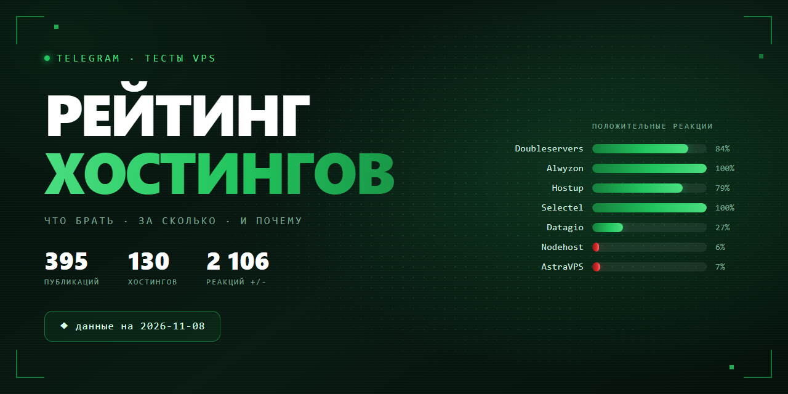

<div align="center">



**VPS под ноду, мост или бота — обзоры участников и реакции сообщества.**

395 публикаций · 130 хостингов · чат Telegram «Тесты VPS» · данные на 2026-11-08

  

</div>

---

## ⚡ Если не хочется читать

Ниже — кандидаты из сообщества под разные задачи. Процент отражает реакции на публикации, а не вероятность бесперебойной работы. Цены, доступность из РФ и условия покупки проверяйте для выбранного тарифа.

| Задача | Кого посмотреть | На чём основан совет |
|---|---|---|
| Нода, панель или бот в Европе | **[Doubleservers](https://doubleservers.com)** | 84% · 69 реакций · 11 постов в оценке · 8 авторов. Последний пост: 2026-11-02. Ноябрьский автор получил машины на тест и сообщил о доступности из РФ на новой сети; независимого подтверждения для всех операторов нет |
| Австрия | **[Alwyzon](https://alwyzon.com)** | 100% · 15 реакций · 2 поста в оценке · 2 автора. Последний пост: 2026-08-20. Малая и уже не новая выборка; прежнее «без моста» не обещает доступность из вашей сети |
| Швеция | **[Hostup](https://hostup.se)** | 79% · 14 реакций · 3 поста в оценке · 3 автора. Последний пост: 2026-09-22. Условия трафика и текущую цену продления проверяйте отдельно |
| Кандидат под мост в РФ | **[Selectel](https://selectel.ru)** | 100% · 9 реакций · 4 поста в оценке · 3 автора. Последний пост: 2026-07-16. Небольшое число реакций; сначала проверьте нужное направление и тариф |

> **Beget:** прежний безусловный совет под мост пересмотрен после [официального сообщения об инциденте](https://beget.com/ru/contacts). Исторические реакции сохранены; подробности и дата проверки — в предупреждениях ниже.

**Высокий процент при малой выборке.** SharpTech — 96% · 27 реакций · 1 пост в оценке · 1 автор, последний пост 2026-06-02. Datalix — 100% · 5 реакций · 1 пост в оценке · 1 автор. Fourplex — 100% · 5 реакций · 1 пост в оценке · 1 автор, но см. ограничения для клиентов из РФ и событие с биллингом ниже. Один хороший обзор и новые реакции к нему не заменяют свежий тест и наблюдение за стабильностью.

### Где аудитория преимущественно реагирует отрицательно

| Хостинг | Реакции и посты | Как читать |
|---|---|---|
| **AstraVPS** | 7% · 148 реакций · 16 постов в оценке · 12 авторов | В текстах есть жалобы на CPU steal, сеть и изменение условий; это опыт авторов на конкретных услугах |
| **Nodehost** | 6% · 131 реакция · 12 постов в оценке · 8 авторов | Авторы сообщают о простоях и проблемах выдачи/поддержки |
| **ExpressHost** | 18% · 114 реакций · 12 постов в оценке · 9 авторов | Встречаются жалобы на ограничения CPU, сеть и доступность IP |
| **Datagio** | 27% · 128 реакций · 18 постов в оценке · 11 авторов | Авторы описывают простои, CPU steal и обращения в поддержку |

**Puws.Cloud** остаётся вне рейтинга: с 09.10 в сообществе отмечено прекращение работы. Старые положительные обзоры не служат рекомендацией покупки.

---

## 🎯 Что проверить под свою задачу

| Задача | Откуда начать | Что остаётся проверить |
|---|---|---|
| **Нода без моста из РФ** | В старых текстах такой опыт описан у Alwyzon; в ноябрьском обзоре — у Doubleservers | Конкретный оператор, регион, IP-пул, протокол и дата. Доступность в одном тесте не распространяется на все сети |
| **Нода через мост** | Doubleservers и другие варианты из таблицы с подходящей локацией | Весь маршрут через выбранный мост, FUP, условия публичного VPN, долгую нагрузку |
| **Мост в РФ** | Selectel; новые обзоры Procloud и Turtleguard — только как материал для собственной проверки | У Procloud встречаются противоречащие сведения о полосе и доступности; Beget требует проверки состояния нужного продукта после инцидента |
| **Панель и бот** | Ориентируйтесь на длительность наблюдения, резервные копии и восстановление | Не выбирайте только по разовому спидтесту; доступ к панели и сохранность данных — отдельные свойства |
| **Региональные сервисы** | Смотрите нужную страну и дату конкретного поста | GeoIP, HTTPS-ответ сайта и полноценная работа сервиса — разные проверки; ограничения аккаунта также влияют |

Покупайте конкретную услугу, а не название ASN. В этом обновлении **HSHP и Hip-Hosting**, **MHost и Midas Hosting**, **ASDhere и Waicore** учитываются отдельно. Обзоры VibeHost и ZaNet относятся к продавцу услуги, а не автоматически к Hetzner/OVH или DataCheap. Общая сеть сама по себе не доказывает единые условия сервиса.

До оплаты уточните обычную цену и продление, IPv4, трафик в обе стороны, FUP, доплаты, возврат, разрешённый сценарий и способ оплаты. Редакторская проверка раздела: **08.11.2026**.

---

## 🚨 Прочитайте до покупки

### Подтверждённые инциденты

**Beget.** В [официальном таймлайне](https://beget.com/ru/contacts) описана атака 1–2 ноября и последующее восстановление. На странице, проверенной 08.11.2026, последнее обновление — 07.11 в 03:00 МСК: панель запущена с ограничениями. Это не подтверждает полного восстановления всех продуктов. Перед покупкой проверяйте выбранную услугу и локацию; историческая оценка (88% · 24 реакции · 9 постов в оценке · 6 авторов) не заменяет актуальный статус.

**VMmanager 6 Hosting.** [ISPsystem сообщил об инциденте](https://www.ispsystem.ru/news/post-mortem) у части клиентов и риске для пользовательских секретов и файлов. Сбор данных вредоносным ПО подтверждён, факт и объём передачи данных вендор не подтверждает и не опровергает. Само использование VMmanager не доказывает компрометацию конкретного хостера. Проверяйте сообщения своего провайдера об обновлениях и восстановлении.

**Fourplex.** В [сообщении от 25 октября](https://www.fourplex.net/2026/10/25/billing-system-incident-recovery-and-static-ip-tunneling-discontinuance/) описаны повреждение данных биллинга и перенос системы. Провайдер отдельно заявляет, что VPS продолжали работать и их данные не потеряны. Сентябрьский обзор (100% · 5 реакций · 1 пост в оценке · 1 автор) предшествует событию; не смешивайте сбой биллинга с потерей данных VPS.

В [уведомлении для клиентов из РФ от 30 августа](https://www.fourplex.net/2026/08/30/notice-for-customers-in-the-russian-fededation/) Fourplex сам не рекомендует покупку из РФ и сообщает о фильтрации адресов. Проверено 08.11.2026; старый положительный обзор не отменяет позицию провайдера. Это пересказ его условий, а не самостоятельная правовая оценка.

### История остановившегося сервиса

**Puws.Cloud** — сохранён статус исключения с 09.10.2026 по сообщениям сообщества о прекращении работы и проблемах клиентов. Старые июньские реакции оставлены для истории; ссылки к покупке и рекомендация из подборки убраны. Этот статус не является результатом новой технической проверки в ноябре.

### Правила VPN и маскировки различаются

У [HOSTOFF.NET](https://hostoff.net/ru/terms) подтверждён запрет маскировки под чужие домены; публичный VPN требует предварительного письменного согласования. В ряде случаев правила предусматривают 24 часа на устранение, в отдельных — немедленное прекращение услуги. У [Soulful Hosting](https://soulful.host/legal) для нарушения TLS/SNI описаны предупреждение и **3 дня** на исправление. Сроки не одинаковы: прежнее обобщение исправлено.

У [Alwyzon](https://www.alwyzon.com/en/legal/tos) отдельно запрещены Tor-узлы и torrent-related services. Это не означает автоматического запрета любого персонального VPN. Ограничения других провайдеров, пересказанные в чате, проверяйте по действующим условиям; сообщения участников не заменяют оферту. Проверка источников: **08.11.2026**.

### Качество свидетельств

В **46%** распознанных публикаций есть реферальная пометка или ссылка; это признак аффилиации, а не доказательство недостоверности. **38** постов представителей и **4** сатирических поста исключены из оценки. Бесплатно выданная машина не равна подтверждённой независимости автора: например, это раскрыто в ноябрьском обзоре Doubleservers.

В новых экспортах нет файлов скриншотов. Рейтинг обновляет тексты, реакции и даты; численные бенчмарки на отсутствующих изображениях не проверены. Храните резервные копии вне выбранного провайдера и проверяйте возможность восстановления.

---

## 📊 Полный рейтинг

¹ Авторы постов после исключения представителей и сатиры; независимость аккаунтов не доказана. Реакции не равны уникальным людям. ² Цена — ориентир из текстов или ручной пометки, страны — из текстов либо справочника; текущие тариф и доступность не подтверждены.

Последнее распознанное наблюдение: **2026-11-08** · возраст 0 дн. · 🟢 актуально. Медиа в новых экспортах отсутствуют: численные результаты со скриншотов не проверены.

**Одобрение** — доля положительных реакций. **Порядок** учитывает ещё и то, на скольких реакциях она посчитана: 100% на девяти реакциях — слабее, чем 88% на сорока восьми, поэтому такой хостинг стоит ниже. Сортировка — по Wilson, полоска — по фактической доле плюсов. Это сигнал аудитории, а не измерение надёжности.

<sub>●●● 25+ голосов · ●●○ 10–24 · ●○○ 1–9 &nbsp;|&nbsp; 🏷 есть посты от представителя хостинга &nbsp;|&nbsp; 🎭 есть сатира &nbsp;|&nbsp; 📈 📉 последние 90 дней заметно отличаются &nbsp;|&nbsp; ⚠️ см. актуальные предупреждения выше</sub>

### 🟢 Высокое одобрение

*Высокий показатель реакций с учётом их количества. Не гарантия качества или свежести.*

| # | Хостинг | Реакции + | Цена² | Реакций | Постов в оценке / всего | Авторы¹ | Последний пост в оценке | Тренд | Страны² |
|:---:|---|---|:---:|:---:|:---:|:---:|:---:|:---:|:---:|
| 1 | **[SharpTech](https://shrp.no)** | `██████████` **96%** | $4.8 | 27 ●●● | 1 / 1 | 1 | 2026-06-02 | — | 🇳🇴 |
| 2 | **[Alwyzon](https://alwyzon.com)** | `██████████` **100%** | €4.49 | 15 ●●○ | 2 / 2 | 2 | 2026-08-20 | — | 🇦🇹 |
| 3 | **[Doubleservers](https://doubleservers.com)** | `████████░░` **84%** | €12 | 69 ●●● | 11 / 11 | 8 | 2026-11-02 | 📉 | 🇫🇷🇩🇪🇵🇱 |
| 4 | **Metrabyte** | `██████████` **100%** | 730 ₽ | 10 ●●○ | 1 / 1 | 1 | 2026-08-15 | = | 🇹🇭 |
| 5 | **[Selectel](https://selectel.ru)** | `██████████` **100%** | 250 ₽ | 9 ●○○ | 4 / 4 | 3 | 2026-07-16 | — | 🇷🇺🇰🇿 |
| 6 | **[Beget](https://beget.com)** ⚠️ | `█████████░` **88%** | 660 ₽ | 24 ●●○ | 9 / 9 | 6 | 2026-08-30 | — | 🇷🇺🇱🇻 |
| 7 | **[Hostdzire](https://hostdzire.com)** | `██████████` **100%** | €10 | 8 ●○○ | 1 / 1 | 1 | 2026-09-09 | = | — |
| 8 | **[Datalix](https://datalix.eu)** | `██████████` **100%** | — | 5 ●○○ | 1 / 1 | 1 | 2026-09-12 | = | 🇩🇪 |
| 9 | **[Fourplex](https://www.fourplex.net)** ⚠️ | `██████████` **100%** | $3 | 5 ●○○ | 1 / 1 | 1 | 2026-09-06 | = | 🇺🇸 |
| 10 | **SWE Hosting** | `██████████` **100%** | €4.44 | 5 ●○○ | 2 / 2 | 2 | 2026-11-04 | — | 🇸🇪 |

### 🔵 Умеренное одобрение

*Сигнал слабее верхней группы; смотрите фактическую долю реакций, дату и ограничения.*

| # | Хостинг | Реакции + | Цена² | Реакций | Постов в оценке / всего | Авторы¹ | Последний пост в оценке | Тренд | Страны² |
|:---:|---|---|:---:|:---:|:---:|:---:|:---:|:---:|:---:|
| 11 | **[Hostup](https://hostup.se)** | `████████░░` **79%** | €4.55 | 14 ●●○ | 3 / 3 | 3 | 2026-09-22 | = | 🇸🇪 |
| 12 | **[Turtleguard](https://turtleguard.cloud)** | `██████░░░░` **62%** | $11 | 34 ●●● | 7 / 7 | 4 | 2026-11-01 | = | 🇩🇪🇳🇱🇵🇱 |
| 13 | **[Tihost](https://t.me/Tihost)** | `██████░░░░` **65%** | — | 20 ●●○ | 5 / 5 | 4 | 2026-08-21 | 📉 | 🇫🇮🇩🇪🇵🇱 |
| 14 | **[Xytor](https://xytor.cloud)** 🏷 | `█████░░░░░` **55%** | 690 ₽ | 64 ●●● | 8 / 12 | 7 | 2026-10-30 | 📈 | 🇵🇱 |
| 15 | **H2Nexus** | `███████░░░` **67%** | — | 15 ●●○ | 1 / 1 | 1 | 2026-08-24 | = | 🇫🇮 |
| 16 | **[Soulful Hosting](https://soulful.host)** 🏷 | `█████░░░░░` **53%** | €6 | 64 ●●● | 8 / 10 | 6 | 2026-10-14 | 📉 | 🇪🇪🇵🇱 |
| 17 | **[Akenai](https://akenai.host)** | `█████░░░░░` **51%** | $12.99 | 51 ●●● | 13 / 13 | 10 | 2026-09-16 | 📉 | 🇩🇪🇳🇱🇯🇵🇬🇧🇮🇹 |
| 18 | **[Rawi Host](https://rawi.host)** 🏷 | `████████░░` **80%** | $6.5 | 5 ●○○ | 2 / 5 | 2 | 2026-09-14 | = | 🇳🇱 |
| 19 | **[HSHP](https://hshp.host)** | `█████░░░░░` **54%** | 320 ₽ | 24 ●●○ | 5 / 5 | 2 | 2026-10-05 | = | 🇩🇪🇷🇺 |
| 20 | **[Vyrex](https://vyrex.co)** 🏷 | `█████░░░░░` **49%** | 554 ₽ | 43 ●●● | 9 / 11 | 7 | 2026-09-30 | = | 🇳🇱🇩🇪🇵🇱 |
| 21 | **VerdianCloud** | `██████░░░░` **57%** | €13.25 | 14 ●●○ | 3 / 3 | 2 | 2026-10-16 | = | 🇳🇱 |
| 22 | **[Freakhosting](https://freakhosting.com)** | `██████░░░░` **60%** | 214 ₽ | 10 ●●○ | 3 / 3 | 2 | 2026-06-12 | — | 🇩🇪🇺🇸 |
| 23 | **StenCloud** 🏷 | `████░░░░░░` **45%** | €6 | 40 ●●● | 5 / 6 | 5 | 2026-10-12 | = | 🇪🇪🇳🇱 |

### 🟡 Смешанный сигнал

*Реакции расходятся либо их мало для высокого показателя.*

| # | Хостинг | Реакции + | Цена² | Реакций | Постов в оценке / всего | Авторы¹ | Последний пост в оценке | Тренд | Страны² |
|:---:|---|---|:---:|:---:|:---:|:---:|:---:|:---:|:---:|
| 24 | **[CiraCloud](https://t.me/ciraCloud_bot)** | `████░░░░░░` **43%** | 319 ₽ | 37 ●●● | 5 / 5 | 3 | 2026-11-03 | = | 🇵🇱🇫🇮 |
| 25 | **[Cloudrix](https://cloudrix.ru)** | `██████░░░░` **60%** | — | 5 ●○○ | 1 / 1 | 1 | 2026-05-20 | — | 🇷🇺 |
| 26 | **VibeHost** | `█████░░░░░` **50%** | €12 | 8 ●○○ | 2 / 2 | 2 | 2026-09-21 | — | 🇩🇪🇫🇷 |
| 27 | **[Datagio](https://datagio.net)** 🏷 | `███░░░░░░░` **27%** | 434 ₽ | 128 ●●● | 18 / 20 | 11 | 2026-10-07 | = | 🇩🇪🇳🇱🇵🇱🇪🇪 |
| 28 | **[Quicksrv](https://quicksrv.io)** | `███░░░░░░░` **33%** | €4.5 | 27 ●●● | 2 / 2 | 1 | 2026-10-28 | = | 🇳🇱🇬🇧 |
| 29 | **[Play2Go](https://play2go.cloud)** 🎭 | `███░░░░░░░` **27%** | 615 ₽ | 79 ●●● | 5 / 6 | 4 | 2026-10-06 | 📈 | 🇩🇪🇵🇱🇸🇪 |
| 30 | **[Aeza](https://aeza.net)** | `██░░░░░░░░` **25%** | €5.93 | 81 ●●● | 11 / 11 | 7 | 2026-09-25 | 📉 | 🇫🇮🇩🇪🇷🇺 |
| 31 | **[Dedicate IT](https://t.me/dedicate_it_bot)** | `████░░░░░░` **43%** | 599 ₽ | 7 ●○○ | 1 / 1 | 1 | 2026-06-27 | — | 🇩🇪 |

### 🔴 Низкое одобрение

*Низкий показатель по реакциям аудитории; причины нужно читать в самих обзорах.*

| # | Хостинг | Реакции + | Цена² | Реакций | Постов в оценке / всего | Авторы¹ | Последний пост в оценке | Тренд | Страны² |
|:---:|---|---|:---:|:---:|:---:|:---:|:---:|:---:|:---:|
| 32 | **Cherry Servers** | `███░░░░░░░` **31%** | — | 16 ●●○ | 2 / 2 | 1 | 2026-09-21 | = | 🇸🇪🇳🇱 |
| 33 | **[1cent.host](https://1cent.host)** | `██░░░░░░░░` **24%** | 646 ₽ | 41 ●●● | 5 / 5 | 5 | 2026-10-28 | = | 🇩🇪🇪🇪🇫🇮 |
| 34 | **[Clouvider](https://clouvider.com)** | `████░░░░░░` **38%** | €4.05 | 8 ●○○ | 1 / 1 | 1 | 2026-06-07 | — | 🇳🇱 |
| 35 | **[Forestsnet](https://forestsnet.cloud)** | `████░░░░░░` **38%** | €4.8 | 8 ●○○ | 3 / 3 | 3 | 2026-08-10 | 📉 | 🇳🇱 |
| 36 | **[Hosting-Russia](https://hosting-russia.ru)** | `████░░░░░░` **38%** | 250 ₽ | 8 ●○○ | 2 / 2 | 2 | 2026-10-05 | = | 🇷🇺 |
| 37 | **[ExpressHost](https://t.me/ExpressHost_Bot)** | `██░░░░░░░░` **18%** | $3.505 | 114 ●●● | 12 / 12 | 9 | 2026-09-22 | 📉 | 🇳🇱🇪🇪🇵🇱 |
| 38 | **PowerRDP** 🎭 | `██░░░░░░░░` **24%** | $6 | 17 ●●○ | 2 / 3 | 2 | 2026-08-25 | 📉 | 🇵🇱 |
| 39 | **[OneDash](https://t.me/OneDash)** | `█░░░░░░░░░` **14%** | 214 ₽ | 76 ●●● | 10 / 10 | 6 | 2026-09-12 | 📉 | 🇩🇪🇳🇱🇺🇸🇷🇺🇫🇮 |
| 40 | **Eternity Cloud** 🏷 | `██░░░░░░░░` **16%** | €8 | 25 ●●● | 3 / 4 | 3 | 2026-11-05 | = | 🇪🇪🇩🇪 |
| 41 | **[Procloud](https://procloud.ru)** | `██░░░░░░░░` **18%** | 500 ₽ | 11 ●●○ | 2 / 2 | 2 | 2026-11-03 | = | 🇷🇺 |
| 42 | **LunarHost** | `█░░░░░░░░░` **13%** | 600 ₽ | 31 ●●● | 3 / 3 | 1 | 2026-09-20 | = | 🇳🇱🇩🇪 |
| 43 | **[VoltNode](https://t.me/voltnode_bot)** | `█░░░░░░░░░` **13%** | 699 ₽ | 23 ●●○ | 2 / 2 | 2 | 2026-09-22 | = | 🇩🇪 |
| 44 | **[Hip-Hosting](https://hip.hosting)** | `█░░░░░░░░░` **12%** | $2.4 | 24 ●●○ | 5 / 5 | 5 | 2026-10-10 | = | 🇪🇪🇱🇹 |
| 45 | **[Intezio](https://intezio.net)** | `██░░░░░░░░` **15%** | 310 ₽ | 13 ●●○ | 2 / 2 | 2 | 2026-07-23 | — | 🇵🇱 |
| 46 | **[AstraVPS](https://astravps.ru)** 🏷 🎭 | `█░░░░░░░░░` **7%** | 460 ₽ | 148 ●●● | 16 / 20 | 12 | 2026-10-15 | = | 🇪🇪🇫🇮🇳🇱🇩🇪🇵🇱 |
| 47 | **[Awas](https://awas.ovh)** | `██░░░░░░░░` **20%** | 300 ₽ | 5 ●○○ | 2 / 2 | 2 | 2026-09-27 | — | 🇩🇪 |
| 48 | **[Nodehost](https://nodehost.ru)** | `█░░░░░░░░░` **6%** | 183 ₽ | 131 ●●● | 12 / 12 | 8 | 2026-11-04 | = | 🇸🇪🇫🇮🇵🇱🇳🇱🇩🇪 |
| 49 | **[MHost](https://mhost.ee)** | `█░░░░░░░░░` **8%** | €6 | 24 ●●○ | 3 / 3 | 2 | 2026-11-06 | = | 🇩🇪🇵🇱 |
| 50 | **[Lili.cloud](https://lili.cloud)** | `█░░░░░░░░░` **11%** | €12.5 | 9 ●○○ | 2 / 2 | 1 | 2026-11-03 | = | 🇳🇱 |
| 51 | **Wuldi** | `█░░░░░░░░░` **9%** | €8 | 11 ●●○ | 4 / 4 | 3 | 2026-10-08 | = | 🇨🇿🇳🇱 |
| 52 | **[It-Garage](https://it-garage.pro)** | `█░░░░░░░░░` **8%** | €6.75 | 12 ●●○ | 1 / 1 | 1 | 2026-06-01 | — | 🇩🇪 |
| 53 | **[ToolVPS](https://toolvps.com)** | `█░░░░░░░░░` **8%** | — | 12 ●●○ | 2 / 2 | 2 | 2026-09-09 | = | 🇳🇱 |
| 54 | **[Qwins](https://qwins.co)** | `░░░░░░░░░░` **4%** | $5 | 49 ●●● | 5 / 5 | 5 | 2026-08-23 | = | 🇵🇱🇳🇱 |
| 55 | **[Hostes.io](https://hostes.io)** 🏷 | `░░░░░░░░░░` **2%** | $15 | 48 ●●● | 4 / 6 | 4 | 2026-08-25 | = | 🇳🇱🇵🇱 |
| 56 | **[VpsPay](https://t.me/VPSPay_bot)** | `░░░░░░░░░░` **0%** | $3.9 | 44 ●●● | 3 / 3 | 3 | 2026-11-06 | = | 🇫🇮 |
| 57 | **[AdminVPS](https://adminvps.ru)** | `░░░░░░░░░░` **0%** | 799 ₽ | 34 ●●● | 2 / 2 | 2 | 2026-09-05 | = | 🇷🇺🇵🇱 |
| 58 | **[Xorek](https://xorek.cloud)** | `░░░░░░░░░░` **0%** | — | 15 ●●○ | 2 / 2 | 2 | 2026-10-28 | = | 🇷🇺 |
| 59 | **[4VPS](https://4vps.su)** | `░░░░░░░░░░` **0%** | 590 ₽ | 12 ●●○ | 3 / 3 | 2 | 2026-05-28 | — | 🇭🇰🇺🇸🇦🇹 |
| 60 | **[H1Cloud](https://h1cloud.net)** 🏷 | `░░░░░░░░░░` **0%** | 150 ₽ | 11 ●●○ | 1 / 2 | 1 | 2026-07-20 | — | 🇨🇭 |
| 61 | **[ZaNet Cloud](https://t.me/ZaNetCloud_bot)** | `░░░░░░░░░░` **0%** | 639 ₽ | 10 ●●○ | 1 / 1 | 1 | 2026-09-04 | = | 🇳🇱 |
| 62 | **Dataforest** | `░░░░░░░░░░` **0%** | — | 9 ●○○ | 1 / 1 | 1 | 2026-09-13 | = | — |
| 63 | **[MTW](https://mtw.ru)** | `░░░░░░░░░░` **0%** | 385 ₽ | 7 ●○○ | 1 / 1 | 1 | 2026-05-14 | — | 🇷🇺 |
| 64 | **[NodexGo](https://t.me/NodexGoBot)** | `░░░░░░░░░░` **0%** | — | 7 ●○○ | 1 / 1 | 1 | 2026-09-28 | = | — |
| 65 | **[ITLDC](https://itldc.com)** | `░░░░░░░░░░` **0%** | $4.35 | 6 ●○○ | 2 / 2 | 2 | 2026-10-30 | = | 🇱🇻 |
| 66 | **[Serverspace](https://serverspace.ru)** | `░░░░░░░░░░` **0%** | — | 6 ●○○ | 2 / 2 | 2 | 2026-08-31 | — | 🇳🇱🇰🇿 |
| 67 | **SmartApe** | `░░░░░░░░░░` **0%** | 510 ₽ | 6 ●○○ | 1 / 1 | 1 | 2026-08-29 | = | — |
| 68 | **[UFO Hosting](https://ufo.hosting)** | `░░░░░░░░░░` **0%** | — | 6 ●○○ | 1 / 1 | 1 | 2026-09-12 | = | — |
| 69 | **DieselHost** | `░░░░░░░░░░` **0%** | 277 ₽ | 5 ●○○ | 1 / 1 | 1 | 2026-07-22 | — | 🇵🇱 |

### ⛔ Остановившиеся сервисы — вне рейтинга

Сохранённые статусы сообщества о прекращении работы. Старые обзоры не являются актуальной рекомендацией, поэтому место в таблице эти бренды не занимают. Одобрение до статуса оставлено для истории; новая техническая проверка не выполнялась.

| Хостинг | С какого числа | Что случилось | Одобрение до статуса |
|---|:---:|---|:---:|
| **Puws.Cloud** ⛔ | 2026-10-09 | В августе проект продан, основатель ушёл. С сентября падения «каждые 2 дня», клиентам переустанавливали ВМ без бэкапа и подгружали сканер портов. 09.10 лёг целиком; к 13–14.10 в «Обсуждении» констатируют «заскамились», «смерть» | 54% · 28 гол. |

### ⚪ Мало данных

60 брендов набрали меньше 5 голосов. Это не оценка — по ним просто нечего считать, и ставить их рядом с остальными было бы враньём.

<details><summary>Показать список</summary>

| Хостинг | Постов в оценке / всего | Реакций | Страны² |
|---|:---:|:---:|:---:|
| **Nivaro** 🏷 | 1 / 6 | 1 | 🇪🇪 |
| **[Veesp](https://veesp.com)** | 5 / 5 | 0 | 🇸🇪🇱🇻🇳🇱 |
| **[Alterra.host](https://alterra.host)** 🏷 | 0 / 3 | 0 | — |
| **[DHostvps](https://t.me/dhostVPS_bot)** | 3 / 3 | 4 | 🇩🇪 |
| **Infrawire** | 3 / 3 | 2 | 🇫🇷🇩🇪 |
| **[Netgrid](https://netgrid.host)** | 3 / 3 | 4 | 🇧🇬🇵🇱 |
| **Phylex** 🏷 | 0 / 3 | 0 | — |
| **[Waicore](https://waicore.net)** | 3 / 3 | 1 | 🇩🇪🇫🇮 |
| **[ASDhere](https://asdhere.net)** | 2 / 2 | 2 | 🇫🇮 |
| **[Bluevps](https://bluevps.com)** | 2 / 2 | 3 | 🇪🇪 |
| **DeluxHost** | 2 / 2 | 4 | 🇳🇱 |
| **[HostKey](https://hostkey.com)** | 2 / 2 | 0 | — |
| **[IShosting](https://ishosting.com)** | 2 / 2 | 0 | 🇰🇿🇸🇪 |
| **[Infomaniak](https://infomaniak.com)** | 2 / 2 | 1 | 🇨🇭 |
| **[On1x](https://on1x.cloud)** 🏷 | 0 / 2 | 0 | — |
| **[Serv.host](https://serv.host)** | 2 / 2 | 1 | 🇪🇪 |
| **[Upcloud](https://upcloud.com)** | 2 / 2 | 3 | 🇩🇪 |
| **[Yottasrc](https://yottasrc.com)** | 2 / 2 | 3 | 🇳🇱🇸🇪 |
| **AVAServer** | 1 / 1 | 0 | 🇰🇿 |
| **[Adman](https://adman.com)** | 1 / 1 | 4 | — |
| **[AlexHost](https://alexhost.com)** | 1 / 1 | 0 | 🇧🇬🇸🇪 |
| **[Atoro](https://atoro.net)** 🏷 | 0 / 1 | 0 | 🇵🇱 |
| **[Blackmore](https://blackmore.cloud)** | 1 / 1 | 0 | 🇳🇱 |
| **[Dasabo](https://dasabo.com)** | 1 / 1 | 1 | 🇩🇪 |
| **[Dobry.host](https://dobry.host)** | 1 / 1 | 3 | 🇫🇮 |
| **EvonixCloud** | 1 / 1 | 2 | 🇳🇱 |
| **F3 Cloud** | 1 / 1 | 4 | 🇩🇪 |
| **[FirstVDS](https://firstvds.ru)** | 1 / 1 | 4 | 🇷🇺 |
| **[G-Core](https://gcore.com)** | 1 / 1 | 1 | 🇰🇿 |
| **[HOSTOFF.NET](https://hostoff.net)** | 1 / 1 | 2 | 🇵🇱 |
| **[Hetzner](https://hetzner.com)** 🎭 | 0 / 1 | 0 | 🇩🇪🇫🇮 |
| **Hostmenow** | 1 / 1 | 0 | — |
| **[Inferno](https://inferno.name)** | 1 / 1 | 1 | 🇳🇱 |
| **KronosCloud** | 1 / 1 | 2 | 🇩🇪 |
| **Kyonix** | 1 / 1 | 0 | 🇩🇪 |
| **LikeVPS** | 1 / 1 | 0 | 🇰🇿 |
| **[Linode](https://www.linode.com)** | 1 / 1 | 0 | — |
| **[Makecloud](https://makecloud.ru)** | 1 / 1 | 2 | 🇷🇺 |
| **[MarshallHost](https://marshallhost.com)** | 1 / 1 | 3 | — |
| **[Melbicom](https://melbicom.net)** | 1 / 1 | 3 | 🇳🇬 |
| **[Netangels](https://netangels.ru)** | 1 / 1 | 0 | 🇷🇺 |
| **[Pirs.host](https://pirs.host)** 🏷 | 0 / 1 | 0 | 🇩🇪 |
| **[Profitserver](https://profitserver.ru)** | 1 / 1 | 1 | 🇨🇭 |
| **[Purecloud](https://t.me/purecloud_robot)** | 1 / 1 | 1 | 🇵🇱 |
| **[RU-Center](https://nic.ru)** | 1 / 1 | 3 | — |
| **[Rabisu](https://rabisu.com)** | 1 / 1 | 3 | 🇹🇷 |
| **[Realtoxmedia](https://realtoxmedia.de)** | 1 / 1 | 2 | 🇩🇪 |
| **[Rifty](https://rifty.org)** | 1 / 1 | 2 | 🇩🇪 |
| **[RubyHost](https://t.me/rubyhostapp)** 🏷 | 0 / 1 | 0 | 🇩🇪 |
| **[ServCity](https://servcity.org)** | 1 / 1 | 4 | — |
| **[Skrime](https://skrime.eu)** | 1 / 1 | 2 | 🇩🇪 |
| **[TNAHosting](https://tnahosting.net)** | 1 / 1 | 3 | 🇺🇸 |
| **[TimeWeb](https://timeweb.cloud)** | 1 / 1 | 3 | 🇷🇺 |
| **[UltaHost](https://ultahost.com)** | 1 / 1 | 2 | 🇰🇷 |
| **VDSKA** | 1 / 1 | 0 | 🇰🇿 |
| **[Vultr](https://vultr.com)** | 1 / 1 | 0 | 🇸🇬 |
| **[WCLOUD](https://wcloud.host)** 🏷 | 0 / 1 | 0 | 🇳🇱 |
| **[Xenyth](https://xenyth.net)** | 1 / 1 | 2 | 🇨🇦 |
| **[Zeabur](https://zeabur.com)** | 1 / 1 | 0 | 🇯🇵 |
| **[iwihost](https://iwihost.net)** | 1 / 1 | 0 | 🇺🇸 |

</details>

---

## Как это считается

Источник — сообщения чата «Тесты VPS» за 2026-05-13 — 2026-11-08. Парсер отбирает посты с узнанным брендом и достаточным текстом: от 60 символов при ссылке на фото, иначе от 150, с документированными ручными исключениями. Таких **395** по **130 брендам**, из них 69 набрали достаточно реакций для оценки.

### Оценка

Ключ сортировки — **нижняя граница Уилсона при z = 1.96** для доли положительных реакций. Он уменьшает влияние малых выборок:

```
         p̂ + z²/2n − z·√( (p̂(1−p̂) + z²/4n) / n )
оценка = ─────────────────────────────────────────
                      1 + z²/n
```

где `p̂` — доля плюсов, `n` — всего голосов, `z = 1.96`.

Простая сумма «плюсы минус минусы» поощряла бы количество тестов, а не качество: бренд с тридцатью тестами набирает больше просто потому, что его чаще берут. Но реакции зависимы и не равны уникальным клиентам: это формальный ключ сортировки, а не 95%-ная уверенность в качестве или безопасности хостинга.

### Что считается, а что нет

- **658** положительных реакций против **1448** отрицательных.
- **450** реакций (😁 🤣 🤔 и подобные) знака не несут: одинаково часто означают «смешно, потому что хорошо» и «смешно, потому что позор». Они считаются отдельно, а не приписываются к плюсам молча.
- **274** кастом-эмодзи Telegram отдаёт без идентификатора — опознать их нечем. Исключены и показаны здесь, а не растворены в цифрах.
- **4** сатирических обзоров и **38** постов от представителей хостинга в оценку не идут — они помечены 🎭 и 🏷.
- **183 из 395** постов содержат реферальную пометку или ссылку. На позицию это не влияет: оценка считается только из реакций аудитории.

### Реакции на разгромный обзор

Под текстом «самый отвратительный хостинг, кромешный ад за 30 дней» ❤ и 🔥 означают **согласие с критикой**, а не похвалу. Поэтому отклик под разгромным обзором засчитывается в минус. Реальный случай: обзор AdminVPS от 05.09.2026 в текущей выгрузке содержит **28** реакций из положительного списка. После подтверждения негативного вердикта весь знаковый отклик (**28**) интерпретируется как согласие с критикой.

Обратное правило тоже работает: на **положительном** обзоре знак не переворачивается. Отрицательные реакции под положительным текстом сохраняют свой отрицательный знак.

### Чего эта методика не умеет

- **Текущий срез начинается с 2026-05-13.** Прежние версии рейтинга считались по другой методике. Сравнивать старый Score и текущую оценку напрямую нельзя.
- **Один тест — один бренд.** Сравнительные посты приписываются первому упомянутому.
- **Реакция — это не проверка.** Здесь измеряется мнение чата, а не независимое тестирование: люди реагируют и на текст, и на автора, и на мем.
- **63 тестов не собрали ни одной реакции.** Молчание аудитории — не нейтральная оценка, а отсутствие данных.

Разбор по чату «Обсуждение хостингов» — в [DISCUSSION_RATING.md](./DISCUSSION_RATING.md).

---

*Данные на 2026-11-08 · Публикаций: 395 · Брендов: 130*
